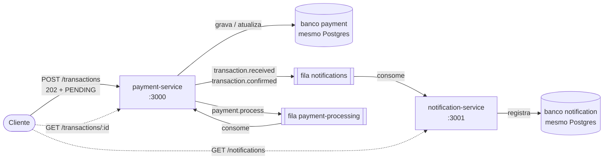

# CompreFácil — Pagamento e Notificação

Desafio 2 de Desenvolvimento de Sistemas Distribuídos (SENAI). Dois microsserviços NodeJS independentes, um de **pagamento** e um de **notificação**, que conversam apenas por mensagens no RabbitMQ. Cada um tem o seu banco no Postgres.

## Arquitetura



| Serviço | REST | AMQP |
|---|---|---|
| `payment-service` | `POST /transactions`, `GET /transactions/:id` | publica em `notifications`; publica e consome `payment-processing` |
| `notification-service` | `GET /notifications?userId=` ou `?transactionId=` | consome `notifications` |

Os serviços não se chamam por HTTP e não importam código um do outro. O que os liga é o formato das mensagens e o nome da fila.

## Fluxo da transação

| Passo do enunciado | Onde acontece |
|---|---|
| I. grava a transação com status pendente | `POST /transactions` grava `PENDING` e responde **202** sem esperar a confirmação |
| II. publica "solicitação recebida" | o Pagamento publica `transaction.received` na fila `notifications` |
| III. Notificação lê e notifica | a Notificação consome, registra no banco e "envia" (log simulado) |
| IV. confirma e muda para sucesso | o consumidor de `payment-processing` espera 5 s (processamento simulado) e muda para `SUCCESS` |
| V. publica "transação confirmada" | o Pagamento publica `transaction.confirmed` na fila `notifications` |
| VI. Notificação lê e notifica | a Notificação consome e registra o segundo aviso |

## Como executar

Pré-requisitos: Docker (Docker Desktop no Windows, aberto e com o motor rodando; no Linux, Docker Engine com o plugin Compose) e Node.js 24 (confira com `node -v`; em versões anteriores à 24.15, o `npm install` mostra avisos `EBADENGINE`, que podem ser ignorados). São três terminais: um para a infraestrutura e um para cada serviço. No Windows, use o PowerShell ou o Git Bash (o `cp` não existe no cmd).

**1. Infraestrutura** (na raiz do repositório):
```bash
cp .env.example .env
```
Troque as senhas `change-me` do `.env` (use só letras, números, `-` e `_`) e suba os containers:
```bash
docker compose up -d --wait
```

**2. Serviço de pagamento** (terminal 2):
```bash
cd payment-service
cp .env.example .env
```
No `payment-service/.env`, troque os `change-me` pelas senhas do `.env` da raiz (`PAYMENT_DB_PASSWORD` e `RABBITMQ_PASSWORD`). Depois:
```bash
npm install
npm run prisma:deploy
npm run start:dev
```

**3. Serviço de notificação** (terminal 3):
```bash
cd notification-service
cp .env.example .env
```
No `notification-service/.env`, use `NOTIFICATION_DB_PASSWORD` e `RABBITMQ_PASSWORD` do `.env` da raiz. Depois:
```bash
npm install
npm run prisma:deploy
npm run start:dev
```

Painéis: RabbitMQ em http://localhost:15672 e pgAdmin em http://localhost:15432 (logins no `.env` da raiz; no pgAdmin, o servidor "CompreFácil" já aparece, com a senha `POSTGRES_ADMIN_PASSWORD`).

## Como testar o fluxo

Criar uma transação no bash (Linux, macOS ou Git Bash):
```bash
curl -X POST http://localhost:3000/transactions -H "Content-Type: application/json" -d "{\"userId\":\"u-10\",\"userEmail\":\"cliente@teste.com\",\"orderId\":\"pedido-1001\",\"amount\":150.5}"
```
No PowerShell:
```powershell
Invoke-RestMethod -Method Post -Uri http://localhost:3000/transactions -ContentType 'application/json' -Body '{"userId":"u-10","userEmail":"cliente@teste.com","orderId":"pedido-1001","amount":150.5}'
```
Resposta esperada (HTTP **202**), com a transação ainda pendente:
```json
{ "id": "ae68a3ad-f09a-460e-88d7-95af615b68b2", "userId": "u-10", "userEmail": "cliente@teste.com",
  "orderId": "pedido-1001", "amount": "150.50", "status": "PENDING", "createdAt": "...", "updatedAt": "..." }
```

Com o `id` da resposta, consulte o status e as notificações (bash):
```bash
curl http://localhost:3000/transactions/<id>
curl "http://localhost:3001/notifications?transactionId=<id>"
```
No PowerShell:
```powershell
Invoke-RestMethod http://localhost:3000/transactions/<id>
Invoke-RestMethod "http://localhost:3001/notifications?transactionId=<id>"
```

O que esperar em cada momento:

| Quando | `GET /transactions/<id>` | `GET /notifications?transactionId=<id>` |
|---|---|---|
| logo depois do POST | `"status": "PENDING"` | uma notificação, `"type": "TRANSACTION_RECEIVED"` |
| uns 5 s depois | `"status": "SUCCESS"` | duas notificações: `TRANSACTION_RECEIVED` e depois `TRANSACTION_CONFIRMED` |

Cada notificação vem assim:
```json
{ "type": "TRANSACTION_CONFIRMED", "transactionId": "ae68a3ad-...", "userId": "u-10",
  "recipient": "cliente@teste.com", "message": "O pagamento de R$ 150.50 do pedido pedido-1001 foi confirmado.", ... }
```

No terminal do **Pagamento** aparecem os passos I, II, IV e V (com o intervalo de ~5 s do processamento simulado):
```text
LOG [TransactionsService] Transação ae68a3ad-... gravada como PENDING
LOG [TransactionsService] Publicado: evento transaction.received da transação ae68a3ad-...
LOG [TransactionsService] Publicado: pedido de processamento da transação ae68a3ad-...
LOG [TransactionsService] Transação ae68a3ad-... confirmada: SUCCESS
LOG [TransactionsService] Publicado: evento transaction.confirmed da transação ae68a3ad-...
```
No terminal da **Notificação** aparecem os passos III e VI:
```text
LOG [NotificationsService] [e-mail simulado] Notificação para o usuário u-10 (transação ae68a3ad-...): Recebemos a sua solicitação de pagamento de R$ 150.50 (pedido pedido-1001). Ela está em processamento.
LOG [NotificationsService] [e-mail simulado] Notificação para o usuário u-10 (transação ae68a3ad-...): O pagamento de R$ 150.50 do pedido pedido-1001 foi confirmado.
```

No **painel do RabbitMQ** (http://localhost:15672, aba *Queues and Streams*) aparecem as filas `notifications` e `payment-processing`, cada uma com 1 consumidor, e as filas de mortas `notifications.dlq` e `payment-processing.dlq`. Com os dois serviços ligados, as mensagens passam rápido e a coluna *Ready* fica em 0. No **pgAdmin**, a tabela `transactions` do banco `payment` mostra o `status` mudando de `PENDING` para `SUCCESS`, e a tabela `notifications` do banco `notification` mostra os dois avisos.

**Independência, nos dois sentidos:**
- Pare a Notificação (Ctrl+C) e faça outro POST. O Pagamento continua respondendo e chega a `SUCCESS` sozinho. No painel do RabbitMQ, a fila `notifications` fica com *Ready* = 2 e 0 consumidores. Ao ligar a Notificação de novo, ela processa as duas mensagens, os dois avisos aparecem no terminal dela e a fila volta a 0.
- Pare o Pagamento e consulte `GET /notifications?transactionId=<id>`: a Notificação continua respondendo normalmente.

## Decisões

**Síncrono e assíncrono.** O cliente fala com a API por HTTP, de forma síncrona: o POST grava a transação, espera o RabbitMQ aceitar as mensagens (até 5 s por mensagem) e responde **202 Accepted** com a transação pendente. O acesso de cada serviço ao seu banco também é síncrono. Entre os serviços não há chamada direta: tudo passa pela fila, de forma assíncrona. Foi escolhido não esperar a confirmação nem a notificação porque a empresa quer uma experiência melhor para o cliente, e num pico de vendas ele não deveria ficar parado enquanto o pagamento é processado. O custo é o cliente consultar o status depois. Se a Notificação estiver fora, o pagamento segue e os avisos esperam na fila.

**Confirmação por uma fila interna.** O POST não confirma o pagamento; ele publica um pedido na fila `payment-processing`, que o próprio Pagamento consome. Foi considerado um temporizador em memória, mas ele se perde se o serviço cair durante o processamento. Na fila durável, o pedido só sai depois do ack, então volta quando o serviço religa (testado derrubando o processo). Também permite que, num pico de vendas, mais instâncias dividam os pedidos de processamento, que é a parte que o enunciado diz consumir mais recursos (testado com duas instâncias: quatro pagamentos divididos dois a dois). Hoje cada instância roda a API e o consumidor juntos; o consumidor poderia virar um processo próprio. O custo é uma fila e um consumidor a mais.

**Mensagens que não se perdem.** As filas são duráveis e as mensagens persistentes, e o RabbitMQ roda com hostname fixo para manter os dados ao recriar o container. Foi considerado o ack automático, que é o padrão do NestJS e mais simples, mas a mensagem sumiria se o serviço caísse no meio do processamento. Por isso os consumidores dão ack **só depois** de processar, e uma queda faz a mensagem ser entregue de novo. Mensagens que nunca vão dar certo (formato inválido, transação inexistente) vão para uma fila de mortas (`*.dlq`), para não travar a fila nem sumir.

**Concorrência e mensagens repetidas.** Ack depois de processar significa que a mesma mensagem pode chegar duas vezes. Isso foi tratado em dois pontos:
- a confirmação muda o status para `SUCCESS` só se ele ainda for `PENDING`, numa única operação no banco. Duas instâncias ou duas entregas do mesmo pedido não confirmam duas vezes: o banco decide quem chega primeiro, sem a condição de corrida de "ler, decidir e gravar";
- a Notificação aceita uma única notificação por id de evento e uma única por transação e tipo. Um aviso repetido é ignorado. O custo aceito é não existir um segundo aviso legítimo do mesmo tipo, caso que o fluxo não tem.

Cada serviço processa uma mensagem por vez (prefetch 1). Com uma instância da Notificação, isso mantém a ordem recebida → confirmada; e o pedido de processamento só é publicado depois de o RabbitMQ aceitar o aviso de recebida.

**Falhas.**
| Falha | O que acontece |
|---|---|
| Notificação fora | o Pagamento continua; os avisos esperam na fila |
| Pagamento fora | a Notificação continua respondendo; pedidos de processamento esperam na fila |
| Banco da Notificação fora | a mensagem volta para a fila a cada 5 s até o banco responder |
| Banco do Pagamento fora | o POST responde erro 500 (nada é gravado); pedidos de processamento voltam para a fila a cada 5 s |
| RabbitMQ fora ao iniciar | os serviços tentam conectar de novo a cada 5 s |
| RabbitMQ fora durante o POST | a transação é gravada e fica `PENDING`; a cada 30 s o Pagamento procura transações paradas e reenvia as mensagens delas, o que é seguro porque todos os passos ignoram repetições |

**Um banco por serviço.** Um servidor Postgres com dois bancos (`payment` e `notification`), cada um com usuário próprio: um serviço não consegue nem conectar no banco do outro. Foram considerados dois servidores, que isolariam também falhas e recursos, mas foi mantido um só para o ambiente de desenvolvimento. O custo é que, se o Postgres cair, os dois ficam sem banco.

## Limitações
- Pagamento e notificação são simulados: todo pagamento é aprovado e a notificação vai para o log, sem e-mail real.
- Não há autenticação, porque o enunciado não pede; por isso as APIs só escutam em `127.0.0.1`.
- Os dois serviços usam o mesmo usuário do RabbitMQ. Num sistema real, cada um teria usuário próprio, com permissão só nas suas filas.
- A recuperação de um POST feito com o RabbitMQ fora leva até cerca de um minuto depois de o RabbitMQ voltar (medido: cerca de 47 s). Quando a fila de processamento está atrasada mais de 30 s, a reconciliação reenvia pedidos que ainda estavam na fila; é seguro, mas gera trabalho repetido.

Detalhes de cada serviço: [`payment-service/README.md`](payment-service/README.md) e [`notification-service/README.md`](notification-service/README.md).

## Problemas comuns
- **Uma senha foi mudada no `.env` da raiz e nada mudou no Postgres.** O script que cria os bancos só roda na primeira subida. Para recriar do zero, rode `docker compose down -v` (apaga os dados do Postgres e as filas do RabbitMQ) e suba de novo.
- **`docker compose up` para com "defina ... no .env".** Falta uma variável no `.env`; compare com o `.env.example`.
- **Porta ocupada** (por exemplo, um Postgres instalado na máquina usando a 5432). O projeto usa as portas 5432, 5672, 15672, 15432, 3000 e 3001; pare o programa que ocupa a porta antes de subir.
- **`docker` não conecta ao motor.** No Windows, o Docker Desktop precisa estar aberto.

## Estrutura
| Caminho | O que é |
|---|---|
| `docker-compose.yml` | Postgres, RabbitMQ (com painel) e pgAdmin |
| `docker/postgres/init/` | cria os bancos e um usuário para cada serviço |
| `docker/pgadmin/servers.json` | servidor já cadastrado no pgAdmin |
| `payment-service/` | serviço de pagamento (NestJS + Prisma) |
| `notification-service/` | serviço de notificação (NestJS + Prisma) |

## Tecnologias
NodeJS 24 com NestJS 12 e TypeScript, Prisma 7 (ORM), zod (validação), RabbitMQ 4.1 e Postgres 17 via docker-compose. O NestJS foi escolhido porque já traz o transporte RabbitMQ e a validação, e os módulos separam bem API, consumidor e banco; é também o framework do material prático da disciplina. Foi considerado Node puro com a biblioteca amqplib, mais simples de ler, mas a reconexão e o tratamento das mensagens teriam de ser escritos à mão. O custo é ter mais camadas para aprender.
